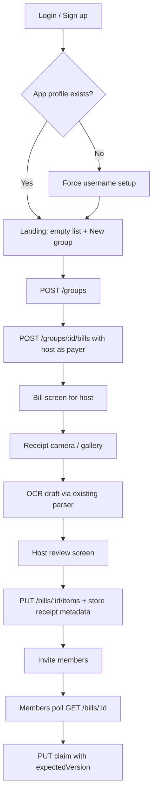

# Groups & bills — implementation plan

Branch: `cursor/groups-bills-plan-dc80`  
Status: **plan only** (no feature code in this PR)

This plan connects the pieces we already have so the product flow becomes:

**Sign up / login → landing page (empty + “New group”) → create group + bill in PostgreSQL → receipt parse → save confirmed receipt → concurrent claim editing**

It builds on `docs/design.md` and the collaboration API already on `main` (`docs/backend.md`).

---

## 0. What already exists (do not rebuild)

| Layer | Status on `main` |
| --- | --- |
| Mobile auth | Supabase email/password; auth-first launch; profile + avatar |
| Collaboration API | Fastify routes for profiles, groups, invites, bills, items, claims, tips |
| PostgreSQL (Tiger Data) | Migration `001_collaboration.sql`: `profiles`, `groups`, `group_members`, `invites`, `bills`, `bill_participants`, `items`, `claims` |
| Auth on API | Bearer Supabase access token → `auth.getUser(token)` → UUID used as `profiles.user_id` |
| Receipt OCR | `POST /api/v1/demo/receipt-extractions` (Gemini / sample); mobile receipt + review screens still write **local demo state** |
| Concurrent edits (server) | Bill `version` + `SELECT … FOR UPDATE` + `409 VERSION_CONFLICT` |
| Concurrent edits (client) | **Not wired** — bill UI still uses in-memory `DemoProvider` |

So this work is primarily **mobile wiring + one receipt-persistence gap**, not a greenfield backend.

---

## 1. Identity model: Supabase Auth vs PostgreSQL

**Important:** we do **not** store groups/bills in a Supabase Postgres “auth database,” and we do **not** rely on Supabase RLS for bill access.

```text
┌─────────────────────┐         Bearer JWT          ┌──────────────────────┐
│  Supabase Auth      │  ◄── verify each request ── │  Fastify API         │
│  (identity only)    │                             │                      │
│  - users / sessions │  returns user.id (UUID)     │  CollaborationService│
│  - user_metadata    │ ─────────────────────────►  │                      │
│    (name, phone,    │                             │         │            │
│     avatar_url)     │                             │         ▼            │
└─────────────────────┘                             │  Tiger Data Postgres │
                                                    │  profiles.user_id    │
                                                    │  = Supabase user id  │
                                                    │  groups, bills, …    │
                                                    └──────────────────────┘
```

### Linking users to app data

1. On sign-up/sign-in, the mobile app holds a Supabase session (`access_token`).
2. First authenticated API call: `GET /api/v1/me` with `Authorization: Bearer <access_token>`.
3. If `profile` is `null`, the client must `PATCH /me` with `username` + `displayName` (derive display name from auth first/last metadata; prompt for a unique username once).
4. All subsequent rows reference `profiles.user_id` (= Supabase Auth user UUID). There is **no cross-database foreign key**; the API is the trust boundary.

### Authorization rules (already enforced in `CollaborationService`)

| Action | Who |
| --- | --- |
| List / read group | Row in `group_members` for that user |
| Create group | Any user with a profile; creator becomes `host_id` + first member |
| Invite / save receipt items / tax settings | Group **host** only |
| Create bill / read bill | Group **member** |
| Claim items / set tip | Group **member** (everyone on the active bill is a payer), own rows only |
| Non-member `GET /bills/:id` | `404` / inaccessible (no bill leakage) |

Clients never get `DATABASE_URL`. Membership checks run inside transactions on every private route. Supabase Storage (receipt images / avatars) stays separate; short-lived upload/read URLs are issued only after the API checks host/membership.

---

## 2. End-to-end product flow



### Step-by-step

1. **Auth** — Existing screens. After session, call `/me` and complete profile if needed before landing.
2. **Landing (replace current demo bill as `index`)** — Empty state + **New group**. Later: list `GET /groups`. Keep the page visually sparse for this milestone.
3. **New group** — Modal/screen: group name → `POST /groups` → immediately `POST /groups/:id/bills` with `participantIds: [self]` (host can add payers later via settings/invites). Navigate to `/groups/[id]/bills/[billId]` (or equivalent).
4. **Receipt** — Reuse current picker + `demo/receipt-extractions` (or bill-scoped extraction once added). Review UI maps draft → `SaveItemsRequest`.
5. **Persist confirmed receipt** — Host submits `PUT /bills/:id/items` (items/tax/service/printed total already in API). **Add** a `receipts` table + upload path for image bytes/metadata (gap today).
6. **Concurrent editing** — Replace demo halves UI with API claims (`fraction` + `expectedVersion`). Poll `GET /bills/:id` ~2s while focused; on `409`, refetch and retry UX.

---

## 3. Implementation phases

### Phase A — API client + profile gate (mobile)

- Add `apps/mobile/src/lib/apiClient.ts`: base URL, attach Supabase `access_token`, typed helpers matching `packages/contracts/src/api.ts`.
- On signed-in entry: `GET /me` → if null, `/profile-setup` (username + display name) before landing.
- Sync display name from auth metadata where useful; username is app-unique and lives only in Tiger Data.

### Phase B — Landing + group/bill creation (mobile)

- Convert `index` from local demo bill → landing: empty copy + **New group**.
- `POST /groups` then `POST /groups/:id/bills`.
- New routes e.g. `group/[groupId].tsx`, `bill/[billId].tsx` (move claim UI off demo state).
- Optional this phase: invite link/QR using `POST …/invites` + `POST /invites/:token/accept`.

### Phase C — Receipt → database

- Keep OCR adapter; after host confirms review, call `PUT /bills/:id/items` with current `expectedVersion`.
- Migration `002_receipts.sql` roughly:

  ```sql
  CREATE TABLE receipts (
    bill_id uuid PRIMARY KEY REFERENCES bills(id),
    image_key text NOT NULL,
    parsing_status text NOT NULL,
    extracted_result jsonb,
    created_at timestamptz NOT NULL DEFAULT now()
  );
  ```

- API:
  - `POST /bills/:id/receipt-extractions` — host + EDITING check → multipart proxy; store bytes under `data/receipts/{billId}/` (`image_key` relative path).
  - Persist `image_key` / draft JSON on extract; set `parsing_status` to `verified` when items are saved.
- Mobile: `bill/[billId]/receipt` → review → `PUT …/items` (omit OCR client ids; fold printed tip into `serviceChargeCents`).
- Retire writing confirmed items only into `DemoProvider` for this path.

### Phase D — Concurrent claims UI

- Bill screen reads authoritative `BillResponse`.
- Claims: `PUT /bills/:id/items/:itemId/claim` with exact fractions (not demo halves).
- Polling hook (`useBillPoll`): 2s interval, pause in background, refetch on focus/mutation/409.
- Show version conflicts with “Someone else updated — retry.”
- Host-only controls for receipt edit; every group member is a payer and claims their own shares (+ personal tip).

### Phase E — Cleanup / demo debt

- Remove or quarantine `DemoProvider` participant switching once live path works.
- Keep sample OCR fallback for demos without `GEMINI_API_KEY`.
- Payment stays simulated / out of scope until a later branch.

---

## 4. Ensuring only group members see a bill

Defense in depth (all server-side; mobile is UX only):

1. **Authenticate** — Missing/invalid JWT → `401`. Never trust a client-supplied `userId`.
2. **Authorize membership** — `getBill` / mutations join through `group_members` (and host/participant checks as needed). Outsiders get opaque `404`, not “forbidden but exists.”
3. **Authorize role** — Host vs payer enforced in `CollaborationService` (`403` when wrong role).
4. **No direct DB from clients** — Tiger Data credentials only on API; Supabase anon key cannot read Tiger Data tables.
5. **Receipt images** — Private bucket; upload/download URLs only after host/membership check.
6. **Caching** — Private routes already send `Cache-Control: no-store`.

We will **not** put bill rows in Supabase Auth/Storage as the source of truth. Auth remains identity; PostgreSQL remains application state.

---

## 5. Mobile navigation sketch (after wiring)

```text
(auth) login | signup | verify-email
(app, signed-in)
  index                 → landing (New group)
  profile-setup         → username gate
  profile               → existing
  group/[id]            → members, invites, open bill
  bill/[id]             → claims + polling
  bill/[id]/receipt    → capture
  bill/[id]/receipt-review → confirm → PUT items
  payment               → later / still demo
```

---

## 6. Env / ops checklist

| Variable | Where | Purpose |
| --- | --- | --- |
| `EXPO_PUBLIC_SUPABASE_*` | mobile | Auth session |
| `EXPO_PUBLIC_API_URL` | mobile | Fastify base URL (LAN IP on device) |
| `DATABASE_URL` | API | Tiger Data |
| `SUPABASE_URL` + `SUPABASE_PUBLISHABLE_KEY` | API | Token verification (same project as mobile) |
| `GEMINI_API_KEY` | API | OCR (optional; sample fallback) |

Migrate with `npm run migrate --workspace @splitpool/api` before demoing groups.

---

## 7. Suggested PR sequence (after this plan merges)

1. **Wire API client + profile gate + landing + create group/bill** (smallest vertical slice).
2. **Persist receipt metadata/images + connect review → `PUT …/items`.**
3. **Claims UI + polling + invite join path.**
4. Strip remaining local-demo bill paths.

Each PR should keep `npm run check` green and smoke-test two real Supabase users against a migrated Tiger Data instance.

---

## 8. Out of scope for the groups/bills slice

- Real Stripe collection / issuing
- Supabase Realtime (polling only, per design)
- Group deletion, host transfer, leave/remove member
- Making Supabase Postgres the app database
